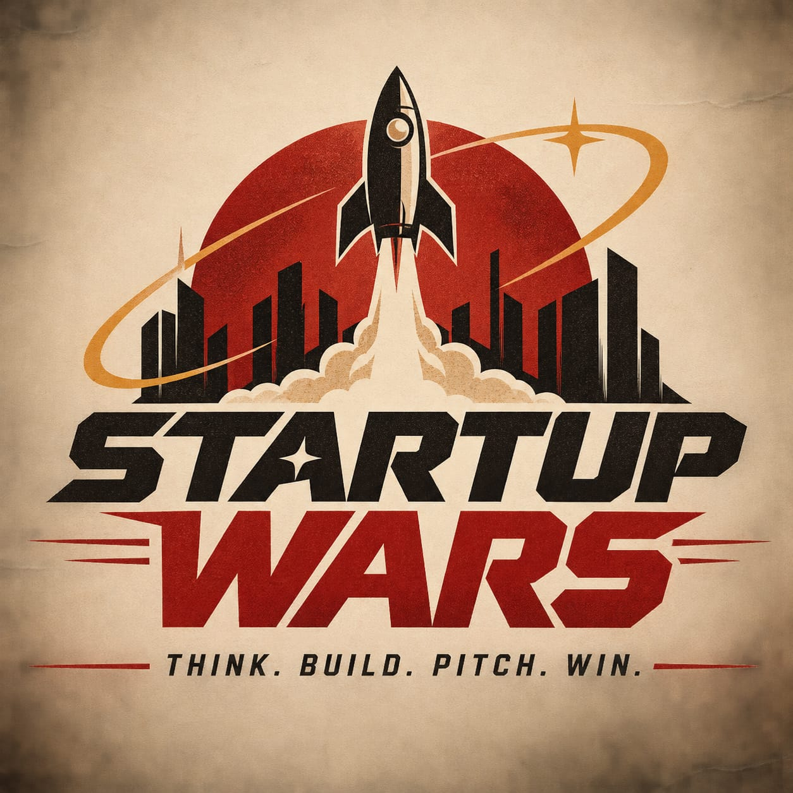
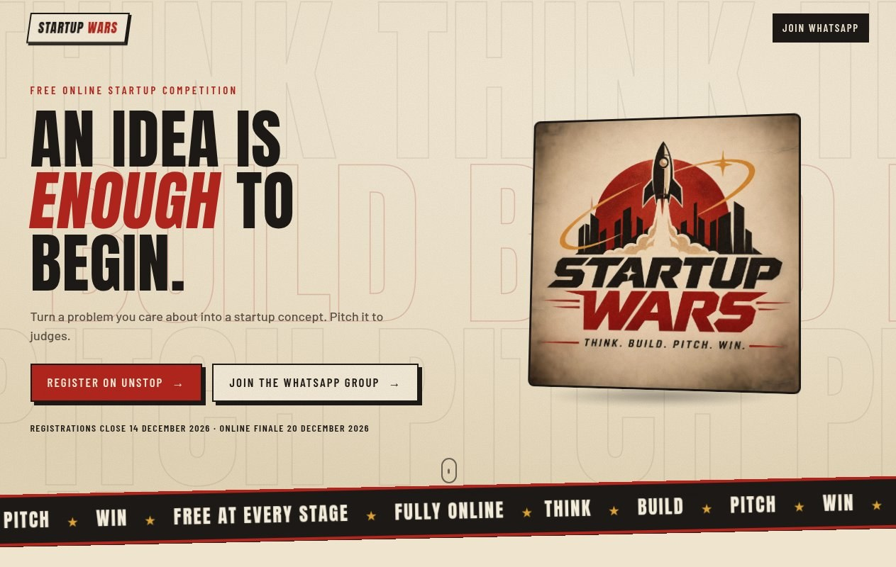
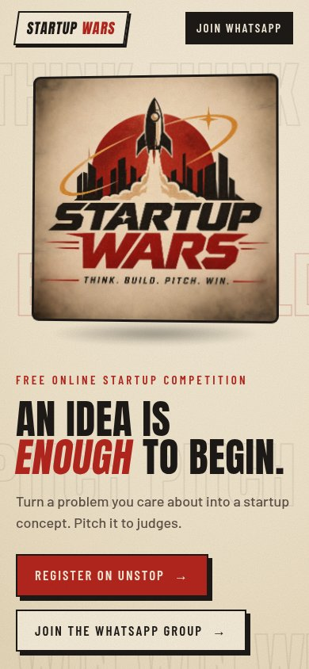

<div align="center">



# STARTUP WARS 2026

**Think. Build. Pitch. Win.**

A free, fully online startup competition for school and college students.
This repository is the event landing page: a single-page site with an animated intro and a 3D hero.

[Register on Unstop](https://unstop.com/o/7FHXcg3) &nbsp;|&nbsp; [Join the WhatsApp community](https://chat.whatsapp.com/E8WtB24JNorFGPiG7sFrkb)

  

</div>



<p align="center">
  
</p>

## What the page covers

- **Intro:** a short animated title sequence (THINK. BUILD. PITCH. WIN.) with a progress bar. Visitors can tap to skip.
- **3D hero:** event logo, tagline, and the Register and Join WhatsApp buttons.
- **Event facts:** free at every stage, fully online, 1-2 members per entry, school and college students welcome.
- **The journey:** four stages: The Idea, The Blueprint, The Final Pitch, and the optional Investor Room.
- **Key dates:** registrations close 14 Dec, idea submission deadline 17 Dec, shortlisting and Blueprint 18-19 Dec, online finale 20 Dec (all 2026).
- **Partners:** Alpha Forge (organiser), The Breakout School (organising partner), Venture Space (investment partner).
- **Mobile friendly:** layouts checked at phone and desktop widths.

The Investor Room is optional and subject to investor availability, and the page states that participation does not guarantee funding.

## Tech stack

- [React 18](https://react.dev) with TypeScript
- [Vite 5](https://vitejs.dev) for dev server and build
- Plain CSS in `src/style.css` (no UI framework)
- Fonts bundled locally: Anton, Barlow, Barlow Condensed

## Getting started

Requires Node.js 18 or newer.

```bash
npm install
npm run dev       # local dev server, http://localhost:5173
npm run build     # production build into dist/
npm run preview   # serve the production build locally
```

## Project structure

```text
.
├── index.html            # page title, description, social tags
├── public/               # favicon and robots.txt (served as-is)
├── src/
│   ├── App.tsx           # all page content, dates, links, intro logic
│   ├── main.tsx          # React entry point
│   ├── style.css         # all styles, animations, intro timing
│   ├── fonts/            # bundled fonts and their OFL license texts
│   └── img/              # event and partner logos
├── docs/                 # README preview images
├── FONT-LICENSES.md      # full font license texts
├── vite.config.js
├── tsconfig.json
└── package.json
```

## Editing the content

| What | Where |
| --- | --- |
| Register link | `REGISTER_URL` at the top of `src/App.tsx` |
| WhatsApp link | `WHATSAPP_URL` at the top of `src/App.tsx` |
| Stages | `STAGES` in `src/App.tsx` |
| Key dates | `DATES` in `src/App.tsx` |
| Event facts | `FACTS` in `src/App.tsx` |
| Colours and spacing | `src/style.css` |
| Intro timing | the two timers (3600 ms minimum, 4500 ms cap) in the intro effect in `src/App.tsx`, plus the `/* intro */` animation delays in `src/style.css` |
| Logos | replace the files in `src/img/` |

## Deploy on Vercel

1. Push this project to a GitHub repository. `node_modules` and `dist` are already git-ignored.
2. In Vercel, choose **Add New > Project** and import the repository.
3. Keep the detected **Vite** framework preset. Build command `npm run build`, output directory `dist`.
4. Click **Deploy**.

You can also deploy from this folder with the Vercel CLI: `npx vercel`.

The build is a static site, so it works on any static host (Netlify, GitHub Pages, Cloudflare Pages) with the same build command and `dist` output.

## After you have a final domain (SEO)

Open `index.html` and:

1. Add `<link rel="canonical" href="https://YOUR-DOMAIN/">`.
2. Change the `og:image` value to a full URL on your domain, so link previews show an image.
3. Optionally add a `sitemap.xml` to `public/` and list it in `public/robots.txt`.
4. Submit the site in Google Search Console. Indexing is up to the search engine and is not guaranteed.

`public/robots.txt` allows crawling by default.

## Assets and licenses

- **Site code:** no license file is included. Add the license you want before publishing the repository. Without one, the default is all rights reserved.
- **Logos:** the Startup Wars, Alpha Forge, The Breakout School and Venture Space logos belong to their respective owners and are included only to show them on the event page. They are not covered by any code license you choose. Do not reuse them outside this event without permission.
- **Fonts:** Anton, Barlow and Barlow Condensed are open source under the SIL Open Font License 1.1. Full texts are in `FONT-LICENSES.md` and `src/fonts/licenses/`.

## Credits

Startup Wars is organised by **Alpha Forge**, with **The Breakout School** as organising partner and **Venture Space** as investment partner.
